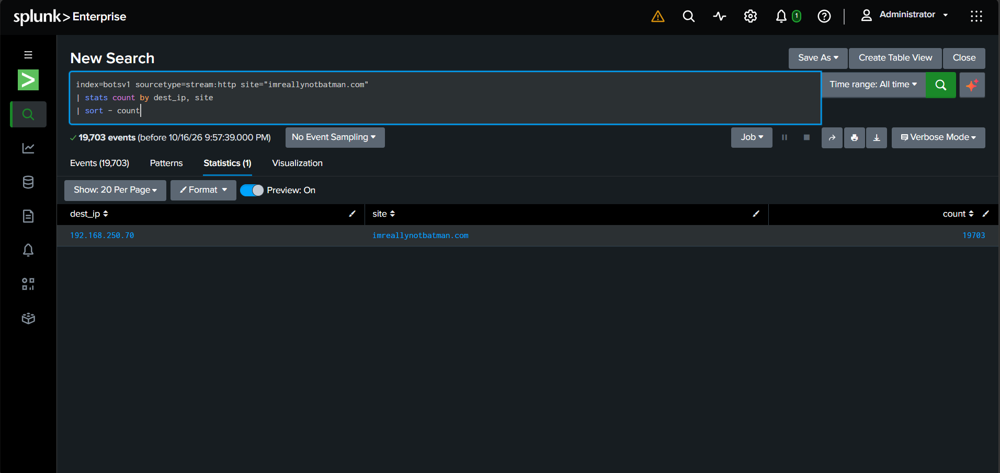
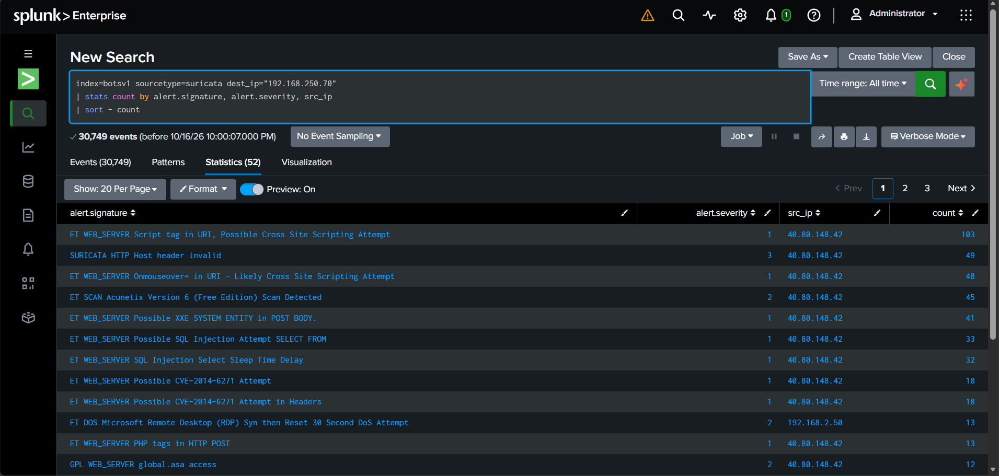
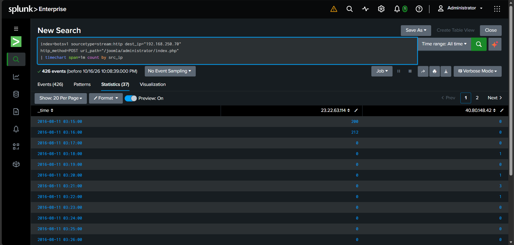
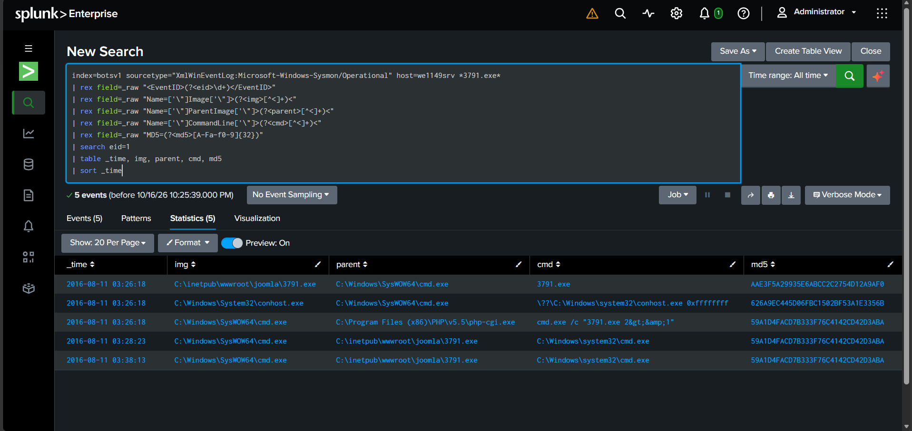
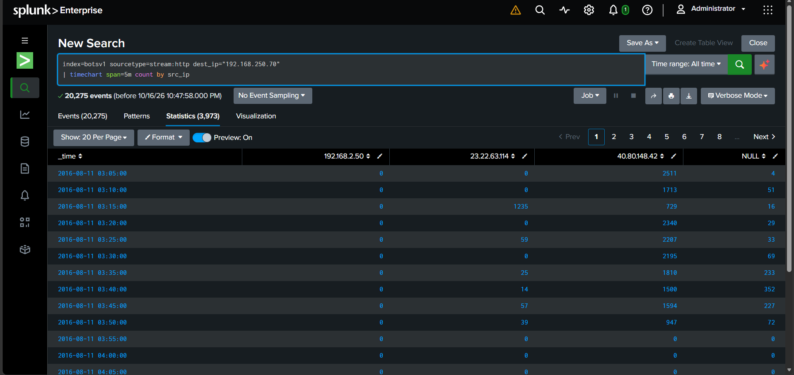

# SOC Analyst Portfolio

I'm Yakub, and I'm working towards a Tier 1 SOC analyst role. This repo holds the hands-on lab work I've done so far: an investigation in Splunk using the Boss of the SOC v1 dataset, and three phishing emails triaged end to end. Each project has its own write-up with the evidence behind my conclusions.

## Repo layout

```
soc-analyst-portfolio/
├── README.md
├── splunk-botsv1-investigation/
│   ├── README.md
│   ├── detections/
│   └── screenshots/
└── phishing-analysis/
    ├── README.md
    ├── reports/
    │   ├── email-01-chase-impersonation.md
    │   ├── email-02-amazon-impersonation.md
    │   └── email-03-iso-attachment.md
    └── screenshots/
        ├── email-01-screenshots/
        ├── email-02-screenshots/
        └── email-03-screenshots/
```

## Project 1: Splunk BOTSv1 investigation

I worked through the BOTSv1 dataset in Splunk and treated each question like an alert I had to triage: ask one question, search the logs with SPL, confirm the result against a second log source, and write down what I found. The detection logic I took from the investigation is in `detections/`, and `screenshots/` shows the searches and results behind my notes.

Write-up: [splunk-botsv1-investigation](./splunk-botsv1-investigation)

## Project 2: Phishing email analysis

Three phishing emails, each written up like a ticket from a user who reported something suspicious. The samples come from the public MalwareCube SOC101 training repo, so they are not live incidents, and I say so in each report.

| # | Email | Main finding | Verdict | Severity |
|---|---|---|---|---|
| 01 | Chase impersonation (2024) | Sent from a Proton Mail account. SPF and DMARC passed, but for protonmail.com and not Chase. Reply-To and Return-Path don't match the From address. | Phishing, sender spoofing | Medium |
| 02 | Amazon impersonation (2023) | Sent as an unrelated company's address through a Sendinblue account. SPF and DKIM passed for bulk-mail domains, DMARC failed, and the "AMAZON.COM" link goes to a click tracker. | Phishing, brand impersonation via abused bulk-email service | Medium |
| 03 | Invoice lure with ISO attachment (2020) | SPF fail, no DKIM, sent from a hosting-provider IP. The `quotation.iso` attachment is flagged by 40 of 61 VirusTotal vendors. | Phishing, malware delivery | High |

Reports:
- [Email 01: Chase impersonation](./phishing-analysis/reports/email-01-chase-impersonation.md)
- [Email 02: Amazon impersonation](./phishing-analysis/reports/email-02-amazon-impersonation.md)
- [Email 03: ISO attachment](./phishing-analysis/reports/email-03-iso-attachment.md)

### How I work an email

1. Open it safely in a Kali VM, with remote content blocked, and keep the original `.eml` untouched.
2. Compare who the email claims to be with what the headers say: From, Reply-To, Return-Path, Message-ID and the Received chain.
3. Read SPF, DKIM and DMARC carefully, including which domain each result applies to. A "pass" for the wrong domain proves nothing.
4. Decode the body and inspect links and attachments without opening them. For attachments I only hash them and search the hash.
5. Check domains, IPs and hashes against passive sources (MXToolbox, VirusTotal search, AbuseIPDB, whois).
6. Write the verdict, severity with the reason for it, defanged IOCs, MITRE ATT&CK mapping and recommended actions.

Every finding is tagged **Confirmed**, **Likely**, **Not determined** or **Not observed**, so it's clear what I saw directly and what I'm inferring. Each report also has a Limitations section.

## Evidence snapshots

A few screenshots from each project. The full set is in each project's folder.

### Splunk BOTSv1

**Top sources hitting the web server.** One IP made up about 86% of the traffic.



**Suricata alerts** for the vulnerability scan against the web server.



**Brute-force timeline.** 412 login attempts in about two minutes, which is automated behavior.



**Sysmon execution.** A PHP process launching the uploaded `3791.exe`.



**Full attack timeline** across both attacker IPs.



### Phishing analysis

**Email 01: raw headers.** Reply-To and Return-Path point to Proton Mail while From says Chase.


**Email 01: header analysis** in MXToolbox.


**Email 02: raw headers.** SPF and DKIM passed for the wrong domains and DMARC failed.


**Email 02: sender domain DMARC.** The domain publishes p=none, so nothing was enforced when its address was spoofed.


**Email 03: VirusTotal hash search.** The attachment is flagged by 40 of 61 vendors. I never opened it.


## Tools used

- **Email and headers:** Thunderbird, Sublime Text, MXToolbox header analyzer, CyberChef
- **Reputation and lookups:** VirusTotal (search only, nothing uploaded), AbuseIPDB, whois, RIPE, DNS lookups for SPF, DKIM and DMARC
- **Attachment handling:** `munpack`, `file`, `sha256sum`, `md5sum`, `grep`
- **Lab:** Kali Linux VM with a snapshot taken first
- **Logs:** Splunk and SPL

## Safe handling

- I never clicked a link or opened, mounted or ran an attachment.
- All indicators are defanged (`hxxps`, `[.]`, `[at]`).
- The ISO from Email 03 is not in this repo, only its hashes. `*.iso` is in `.gitignore` so it can't be pushed by mistake.

## Skills shown

- Email header analysis and spotting sender spoofing
- Reading SPF, DKIM and DMARC alignment correctly
- Safe URL and attachment triage
- Using threat intel without over-trusting it (0 detections is not "clean")
- Judging severity and explaining the reason
- Mapping findings to MITRE ATT&CK
- Writing reports another analyst can follow and escalate from
- Searching and investigating logs in Splunk

## Contact

GitHub: [yakubpashamohammed](https://github.com/yakubpashamohammed)
