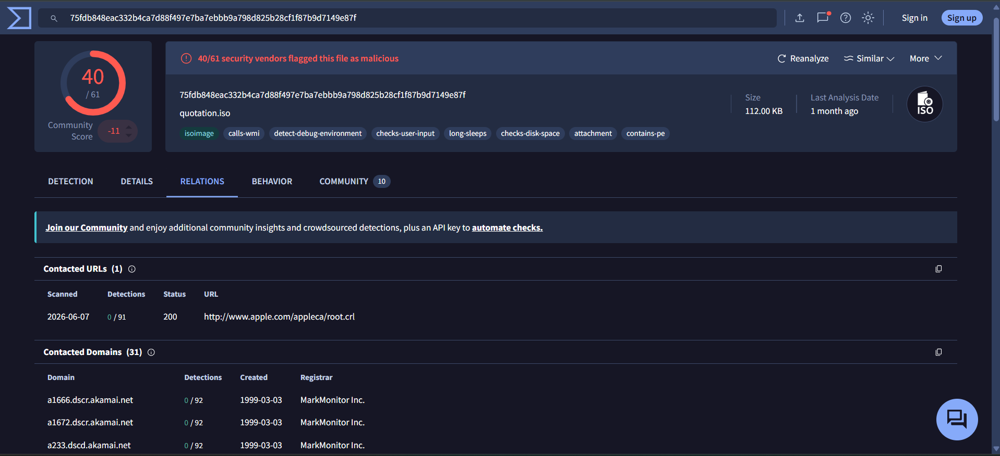
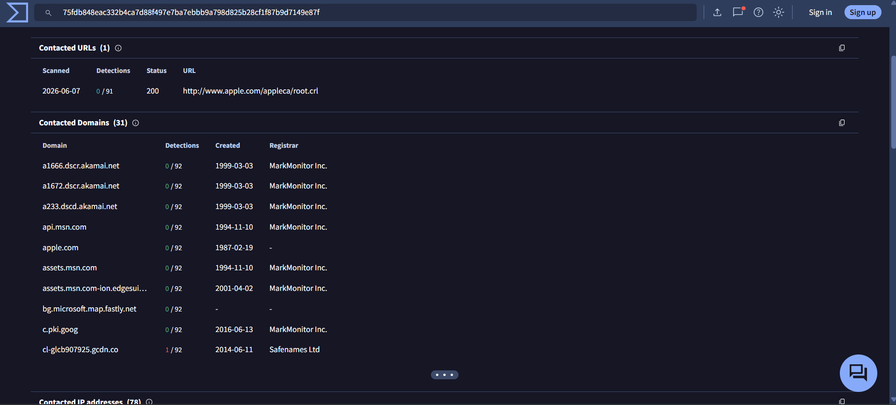
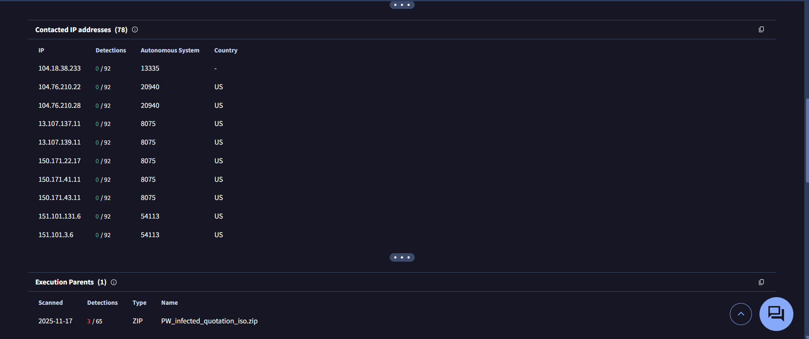
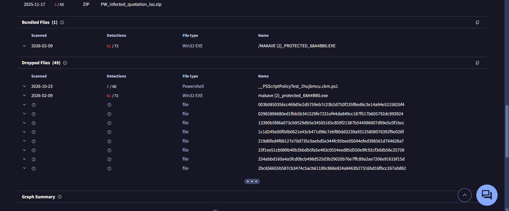
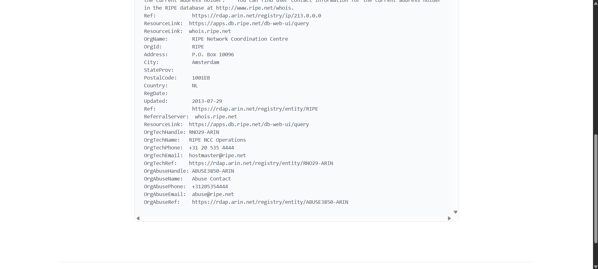
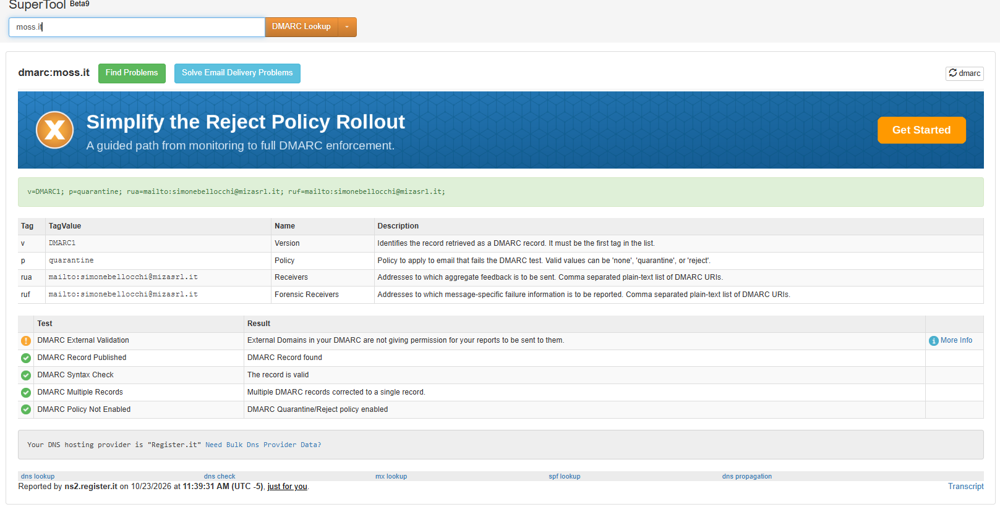
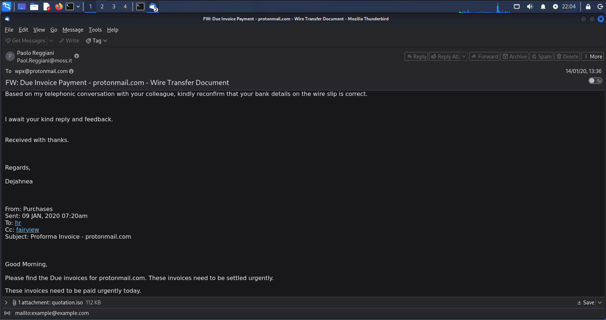

# Email 03: Invoice / Wire Transfer Lure with ISO Attachment

SOC L1 triage report.

## Summary

| Field | Details |
|---|---|
| Subject | FW: Due Invoice Payment - protonmail[.]com - Wire Transfer Document |
| From / Return-Path | Paolo Reggiani, Paol[.]Reggiani[at]moss[.]it (same in both) |
| To | wpx[at]protonmail[.]com |
| Date header | 2020-01-14 00:06:05 -0800 (08:06:05 UTC) |
| Received by Proton | 2020-01-14 08:06:41 UTC |
| Sending IP | 213[.]227[.]154[.]65 (HELO moss[.]it, rDNS "unknown") |
| Attachment | quotation.iso, 114688 bytes |
| Verdict | Phishing, malware delivery lure |
| Severity | High (Critical if the recipient opened the attachment) |

The email is a fake forwarded invoice that asks the recipient to confirm bank details for a wire transfer. It carries an ISO file named `quotation.iso`. Proton recorded an SPF fail and no DKIM signature. VirusTotal shows 40 of 61 vendors flag the file as malicious, with trojan labels. I never opened the ISO, so I cannot say what the payload does. That is an L2 task.

**Severity rationale:** I rated it High because a file that most vendors flag as malicious was delivered to the mailbox. I did not rate it Critical because I have no evidence the recipient opened or ran it. If the user confirms they opened the ISO, or endpoint logs show it was mounted, the rating goes to Critical and the host is isolated.

## About the sample

This is a training sample from a public GitHub repo (MalwareCube SOC101). In my copy the path was `01_Phishing_Analysis/04_Attachment_Analysis/sample1.eml`. It is not a live incident and the email is dated 2020. Only hashes are published in this repo, and the attachment itself is not included.

All indicators are defanged (`[.]`, `[at]`) so nobody opens or clicks them by mistake.

## Tools and safe handling

I worked in a Kali Linux VM and kept the attachment away from the repo:

- I never opened, mounted or executed the ISO.
- I extracted it to a folder outside the repo, then moved it to a separate quarantine folder.
- I added `*.iso` to `.gitignore` so it cannot be pushed by mistake.
- Tools: Thunderbird (remote content blocked), Sublime Text, MXToolbox, whois, AbuseIPDB, VirusTotal (hash search only, no upload), `grep`, `munpack`, `sha256sum`, `md5sum` and `file`.

## Investigation

### Step 1: Message and headers

I opened the email in Thunderbird and then read the raw headers in Sublime Text. The sender is Paolo Reggiani at moss[.]it, and the From and Return-Path match. The body is signed "Dejahnea", which is a different name from the sender. There is one external hop, from moss[.]it to mailin004[.]protonmail[.]ch over ESMTP, and the Message-ID is `<20200114000605.14F3983143C82AAA@moss[.]it>`.

### Step 2: Authentication

These are the results Proton recorded in 2020. SPF failed for moss[.]it, there was no DKIM signature, and DMARC showed `p=none` for header.from=moss[.]it, which means nothing is enforced. The MXToolbox "SPF Alignment" tick only means the From and Return-Path domains match. It is not an SPF pass, so I did not count it as one.

### Step 3: The attachment (never opened)

I pulled the attachment out of the raw message with `munpack`, checked it with `grep` and `file`, and hashed it.

- Declared type: `application/octet-stream`, filename `quotation.iso`, disposition attachment.
- Real type from `file`: ISO 9660 CD-ROM filesystem, volume label `makave (2)_protected_68A4BB0`. This matches the extension.
- Size: 114688 bytes (112 KiB), the same as Thunderbird shows.
- SHA256: `75fdb848eac332b4ca7d88f497e7ba7ebbb9a798d825b28cf1f87b9d7149e87f`
- MD5: `6aef1d7f88e8aa450a0c604b4caee5ba`

I did not look inside the ISO, because listing or mounting its contents is for L2 in a sandbox.

### Step 4: VirusTotal (hash search only)

I searched the SHA256 on VirusTotal without uploading anything. The MD5, SHA256, size and volume label all match my local results.

- 40 of 61 vendors flag the file as malicious. The vendor labels are trojan.androm/ejzz, with family names androm, ejzz and fareitvb. These are vendor labels and not my own analysis.
- The SHA1 on the Details tab is `3fe45f8cd20cd7c63e55e3918dac1d3a0d7fb05a`.
- First submission was 2020-01-14 15:26:38 UTC, about 7 hours after Proton received the email. This shows the file was circulating that day, not who sent it first.
- VirusTotal's sandbox tags include calls-wmi, detect-debug-environment, checks-user-input, long-sleeps, checks-disk-space and contains-pe.
- VirusTotal lists a bundled file, `MAKAVE (2)_PROTECTED_68A4BB0.EXE` (61/72). I did not extract it.

I left several VirusTotal relations out of the IOCs. The contacted domains and IPs are Apple, Microsoft, Akamai and Fastly infrastructure that the sandbox reached, a ZIP called `PW_infected_quotation_iso.zip` (3/65) is someone's repackaging of the sample, and one contacted domain had a single 1/92 detection. None of these identify the attacker.

### Step 5: Sending IP 213[.]227[.]154[.]65

A generic whois only returned the broad RIPE NCC block 213[.]0[.]0[.]0/8, so I queried RIPE directly. The range is 213[.]227[.]128[.]0 to 213[.]227[.]159[.]255, netname NL-LEASEWEB-20000721, owned by LeaseWeb Netherlands B.V. AbuseIPDB lists the ISP as LeaseWeb, usage type Data Center/Web Hosting/Transit, AS60781, Netherlands.

AbuseIPDB shows a 0% score and no reports. That means the IP is not reported, which is not the same as clean, and the data is from 2026 while the email is from 2020. The key point is that the email was sent from a hosting provider's IP and not from a network owned by moss[.]it. That does not prove spoofing, because the domain owner could rent a server there, but it fits with the SPF fail.

### Step 6: Sender domain moss[.]it

moss[.]it was registered on 2000-04-06, so it was about 20 years old when the email was sent and is not a throwaway domain. The registrant is M.O.S.S. S.r.l. and the registrar is Register S.p.A.

Today's records are different from 2020, so I only used them for context. The domain is in an autoRenewPeriod with expiry 2026-10-14, and MXToolbox flags it as expired. The current SPF record lists `ip4:109[.]168[.]8[.]218` plus includes for Outlook, musvc[.]com and emailsignatures365[.]com, and ends with `~all`. The sending IP 213[.]227[.]154[.]65 is not the listed ip4. I did not expand the includes. The current DMARC policy is `p=quarantine`, while Proton recorded `p=none` in 2020.

I could not tell whether moss[.]it was spoofed or compromised. The verdict does not depend on it, because the attachment is malicious either way. In both cases the domain owner should be told.

### Step 7: Body links

I hovered over the two links in the body. The "hr" link is `mailto:hr[at]example[.]com` and the "fairview" link is `mailto:example[at]example[.]com`. They are placeholder addresses inside a fake forwarded trail, not web links, so there was no URL to analyse.

## Red flags

1. Unsolicited invoice and wire transfer message with urgent payment wording.
2. A request to "reconfirm your bank details".
3. The sign-off name (Dejahnea) does not match the sender (Paolo Reggiani).
4. A fake forwarded trail ("From: Purchases", 09 JAN 2020) made to look like an existing thread.
5. The subject and body use the recipient's own domain as the "customer" name, a sign of a generic mass template.
6. An `.iso` attachment on a payment message. Disk images are a known way to deliver malware.
7. SPF fail and no DKIM from a domain that presents itself as a real business.
8. The attachment is flagged by 40 of 61 VirusTotal vendors.
9. Sent from a hosting-provider IP and not from the domain's own mail servers.

## Conclusion

This is a phishing email with a malicious attachment. The message fails SPF, carries no DKIM signature, comes from a hosting-provider IP, and attaches an ISO that 40 of 61 vendors flag as a trojan. The verdict rests on the attachment and the failed authentication together.

The verdict is **Phishing (malware delivery lure), severity High**. The severity moves to Critical only if the recipient opened the file.

## IOCs (defanged)

| Type | Value | Note |
|---|---|---|
| File name | quotation[.]iso | |
| SHA256 | `75fdb848eac332b4ca7d88f497e7ba7ebbb9a798d825b28cf1f87b9d7149e87f` | Primary IOC |
| SHA1 | `3fe45f8cd20cd7c63e55e3918dac1d3a0d7fb05a` | From VirusTotal Details |
| MD5 | `6aef1d7f88e8aa450a0c604b4caee5ba` | |
| File size | 114688 bytes | |
| ISO volume label | `makave (2)_protected_68A4BB0` | |
| Bundled EXE name (reported by VT) | MAKAVE (2)_PROTECTED_68A4BB0[.]EXE | I did not capture its hash |
| Sender address | Paol[.]Reggiani[at]moss[.]it | Do not block the whole domain |
| Sending IP | 213[.]227[.]154[.]65 | Shared hosting range. Do not block the range |
| HELO | moss[.]it | |
| Message-ID | 20200114000605[.]14F3983143C82AAA[at]moss[.]it | |
| Subject | FW: Due Invoice Payment - protonmail[.]com - Wire Transfer Document | |

I did not list the sandbox domains, the repackaged ZIP or the placeholder `example[.]com` addresses as IOCs.

## MITRE ATT&CK

| ID | Technique | Evidence |
|---|---|---|
| T1566.001 | Phishing: Spearphishing Attachment | Email with an ISO attachment |
| T1204.002 | User Execution: Malicious File | The lure depends on the user opening the attachment. I saw no evidence it was opened |
| T1036 | Masquerading | The ISO is presented as a quotation or payment document |

## Recommended actions

As L1 I would recommend these. Containment and forensics are for L2.

| # | Action | Owner |
|---|---|---|
| 1 | Check whether the recipient opened or saved the attachment (mail logs, endpoint logs and user confirmation) | L1 to L2 |
| 2 | Search mail logs for the SHA256, the subject and the sender address, and remove matching messages | L2 / email admin |
| 3 | Block the SHA256 at the email gateway and endpoint tools | L2 / email admin |
| 4 | If the file was opened, isolate the host, run an EDR scan, and look for the bundled EXE and PowerShell activity | L2 |
| 5 | Detonate the ISO in a sandbox and list its contents (never on the analyst workstation) | L2 / malware analysis |
| 6 | Report the sender IP to the LeaseWeb abuse contact if the sample was live | L2 |
| 7 | Tell the owner of moss[.]it about the abuse of their domain | L2 |
| 8 | Block or warn on disk-image attachments (.iso, .img) at the email gateway | Email admin |
| 9 | User awareness: do not open unexpected invoice or payment attachments | Awareness team |

## Limitations

- This is a training sample from 2020, not a live incident.
- The AbuseIPDB, SPF, DMARC and whois data are from 2026 and can differ from 2020.
- I never opened the ISO, so its contents and the bundled EXE are not analysed. The detection counts and labels are VirusTotal vendor data, and the behaviour tags come from sandboxes.
- I could not tell whether the recipient opened the file, or whether moss[.]it was spoofed or compromised.
- I only partly decoded the raw message source. My link review covers the visible body links that I hovered over.
