# SOC L1 Investigation: Splunk BOTS v1 — Web Server Compromise


## Project Overview

This project documents a Tier 1 SOC investigation using the Splunk Boss of the SOC v1 (BOTSv1) dataset.

The investigation focuses on suspicious activity involving the web server `imreallynotbatman.com` (`192.168.250.70`, host `we1149srv`). I used Splunk Search Processing Language (SPL) to investigate network traffic, Suricata alerts, authentication activity, file uploads, process execution and outbound connections.

My objective was to determine which events were suspicious, correlate related activity, assess the potential impact and prepare an evidence-based escalation for Tier 2.

This was a simulated training investigation, not a production incident. I did not perform containment, malware analysis or forensic remediation.

## Incident Summary

| Field | Details |
|---|---|
| Incident type | Suspected web server compromise |
| Environment | Splunk Enterprise |
| Dataset | Splunk BOTS v1 |
| Affected host | `we1149srv` |
| Server IP | `192.168.250.70` |
| Primary tools | Splunk SPL, Sysmon, Suricata, HTTP and DNS logs |
| Framework | MITRE ATT&CK |
| Overall assessment | Critical — suspected unauthorized access with confirmed executable execution |
| Final disposition | Escalate to Tier 2 |

### Key Findings

- **Reconnaissance:** An external IP, `40.80.148.42`, generated extensive web traffic and vulnerability-scanning alerts.
- **Credential attack:** `23.22.63.114` made 412 POST requests to the Joomla administrator login using an automated Python user agent.
- **Possible credential compromise:** The password `batman` appeared in activity from both external IPs. Successful authentication is inferred from subsequent activity, not established by the HTTP status code alone.
- **Malicious file activity:** The server received `3791.exe` and `agent.php`.
- **Process execution:** Sysmon recorded `php-cgi.exe` launching `cmd.exe`, followed by execution of `3791.exe`.
- **Suspicious outbound activity:** The server requested an image from `prankglassinebracket.jumpingcrab.com` over port `1337`.
- **Outstanding questions:** The payloads were not analyzed, the relationship between the external IPs is not conclusively established, and website defacement was not observed.

> **Important:** BOTSv1 is a simulated dataset. The findings and incident assessment apply to this investigation, not to a real production environment.

## Investigation Environment

| Component | Details |
|---|---|
| Dataset | [Splunk Boss of the SOC v1](https://github.com/splunk/botsv1) |
| Splunk index | `botsv1` |
| Query language | SPL |
| Network logs | `stream:http`, `stream:dns` |
| Security alerts | `suricata` |
| Firewall logs | `fgt_utm` |
| Endpoint telemetry | Sysmon |
| Web server logs | IIS |
| Search window | All time |
| Time zone | IST (UTC+05:30), as displayed in the investigation |

The timestamps below are presented in IST, with UTC equivalents where useful. The incident activity dated 10 August 2016 in UTC falls on 11 August 2016 in IST.

## Repository Structure

```text
splunk-botsv1-investigation/
├── README.md
├── detections/
│   ├── 01_log_inventory.spl
│   ├── 02_top_source_ips.spl
│   ├── ...
│   └── 22_attack_timeline.spl
└── screenshots/
    ├── 01_log_inventory.png
    ├── 02_top_source_ips.png
    ├── ...
    └── 22_attack_timeline.png
```

Each numbered SPL query has a corresponding screenshot containing the search results. The numbering follows the investigation sequence documented below.

## Investigation and Evidence

### Phase 1: Reconnaissance and Initial Triage

#### 01. Log Source Inventory

**File:** `detections/01_log_inventory.spl`

I started by identifying the available log sources and confirming which data could support the investigation.

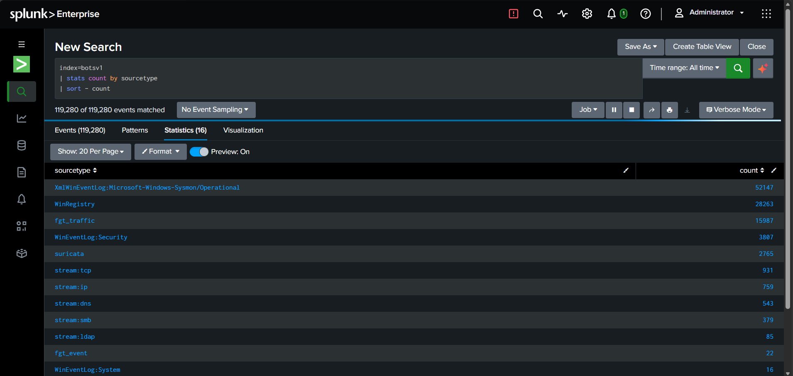

#### 02. Top Source IPs

**File:** `detections/02_top_source_ips.spl`

The HTTP logs showed three main sources communicating with the web server.

- `40.80.148.42`: 17,546 events
- `23.22.63.114`: 1,429 events
- `192.168.2.50`: 214 events

The first IP accounted for approximately 86% of the 20,275 events reviewed. This concentration of traffic justified further investigation but was not, by itself, proof of malicious activity.


#### 03. Suricata Alert Review

**File:** `detections/03_suricata_alerts.spl`

Suricata generated alerts associated with `40.80.148.42`, including:

- Acunetix vulnerability scanning
- Cross-site scripting (XSS)
- XML External Entity (XXE)
- SQL injection
- CVE-2014-6271-related signatures

These alerts indicated vulnerability-testing and exploit-like traffic. I treated the signatures as investigative leads and correlated them with the HTTP evidence.


#### 04. Scanner User-Agent Analysis

**File:** `detections/04_scanner_user_agents.spl`

Most requests used a generic Chrome user-agent string. The HTTP payloads contained `acunetix_wvs_security_test`, consistent with the Suricata scanning alert.

I also identified 61 events using an Internet Explorer 11 user-agent string. That same string appeared later during administrative activity and the file upload.

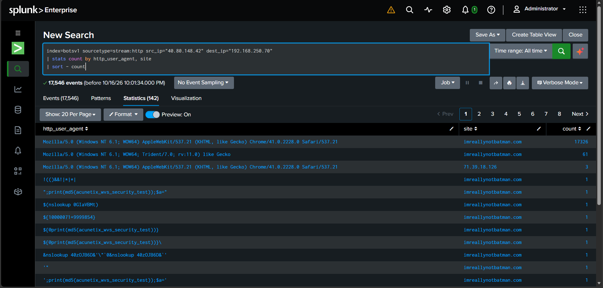

#### 05. Suspicious URL Requests

**File:** `detections/05_scanner_urls.spl`

The logs showed 13,415 requests to `/joomla/index.php/component/search/`, along with probes for paths such as `/windows/win.ini` and `/boot.ini`.

The volume and nature of these requests were consistent with automated reconnaissance and path-discovery attempts.

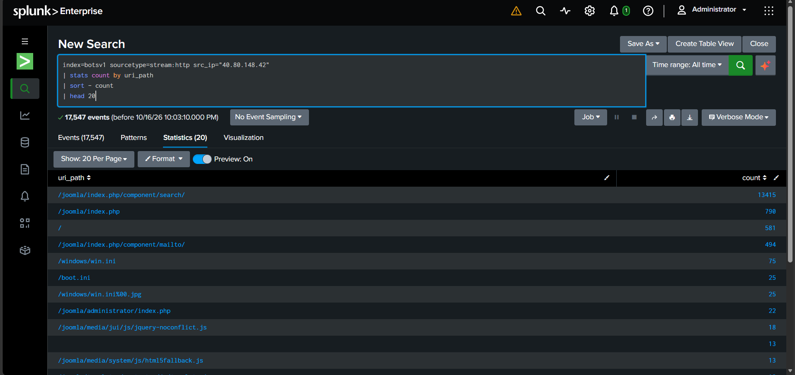

#### 06. Internal Host Review

**File:** `detections/06_internal_host_profile.spl`

The internal host `192.168.2.50` generated 214 requests involving login and administrative paths. The activity included a Nessus-related test string and an RDP SYN-then-reset alert.

The pattern was consistent with possible vulnerability scanning, but I could not confirm authorization from the logs alone.

**Verdict:** Needs verification. Confirm the host's ownership and scanning authorization with the asset inventory or infrastructure team.

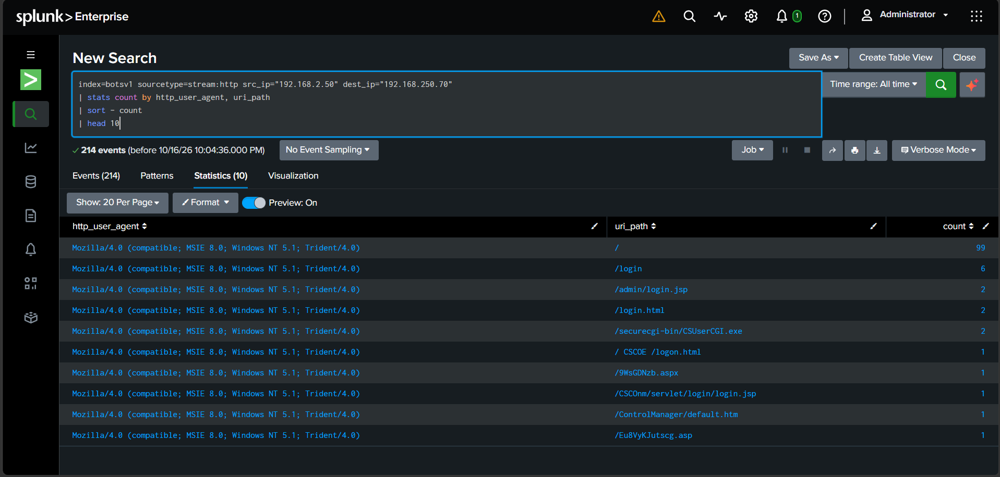

### Phase 2: Credential Attack and Administrative Access

#### 07. Login POST Sources

**File:** `detections/07_bruteforce_sources.spl`

I examined POST requests to the Joomla administrator login endpoint.

- `23.22.63.114`: 412 POST requests using `Python-urllib/2.7`
- `40.80.148.42`: 14 POST requests using an IE11 user-agent string

The Python user agent and request volume suggested automated credential guessing.

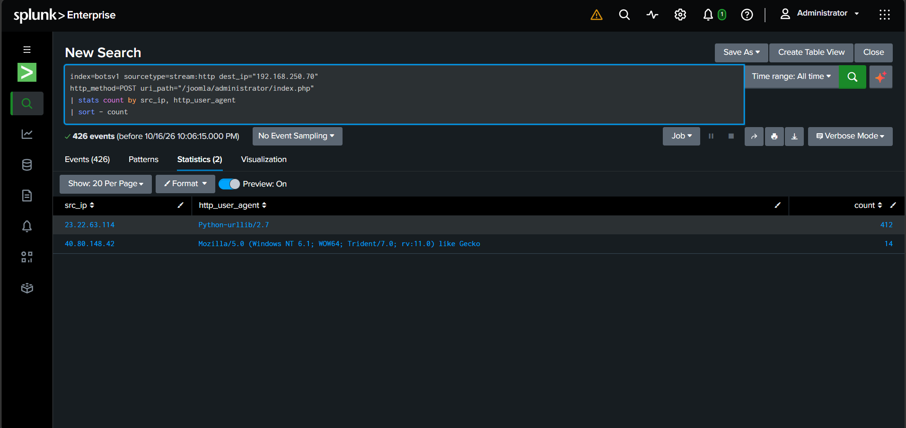

#### 08. Password Attempts

**File:** `detections/08_password_attempts.spl`

The username `admin` was associated with common password guesses, including `12345678`, `letmein`, `qwerty` and similar values.

The attempts began at approximately 03:15:21 IST.

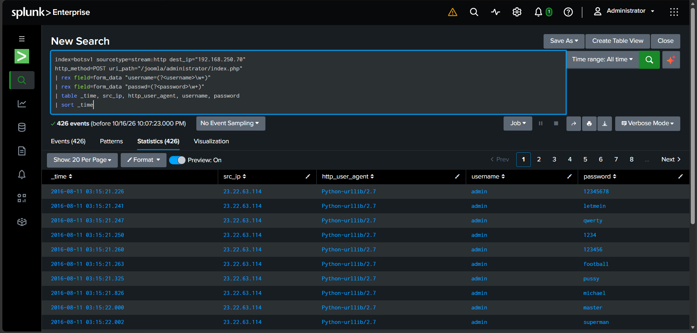

#### 09. Brute-Force Timeline

**File:** `detections/09_bruteforce_timeline.spl`

The activity consisted of:

- 200 attempts during the 03:15 minute
- 212 attempts during the 03:16 minute
- No further attempts in the observed burst

The speed and abrupt stop were consistent with automation.


#### 10. Credential Reuse

**File:** `detections/10_credential_reuse.spl`

The password `batman` appeared in a request from `23.22.63.114` at 03:16:33 IST. Approximately 92 seconds later, `40.80.148.42` submitted the same password using an IE11 user-agent string.

This was a significant correlation point. However, shared credentials and close timing do not independently prove that the two IP addresses were controlled by the same actor.

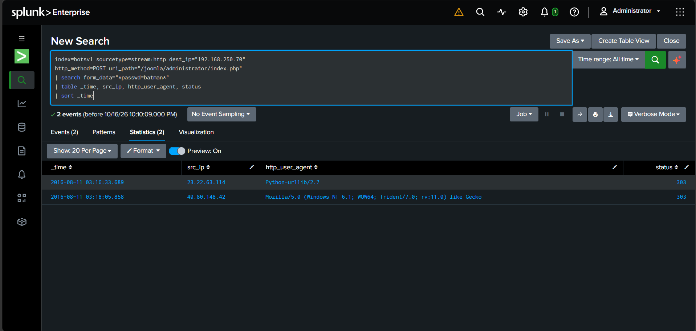

#### 11. Login Status Codes

**File:** `detections/11_login_status.spl`

The login responses included:

- `23.22.63.114`: 411 responses with status 303
- `40.80.148.42`: 12 responses with status 200 and two with status 303

A 303 response occurred in both failed and potentially successful login flows in this dataset. I therefore did not use the status code alone to declare authentication successful.

**Assessment:** Successful administrative access is likely based on the subsequent activity, but it remains an inference.

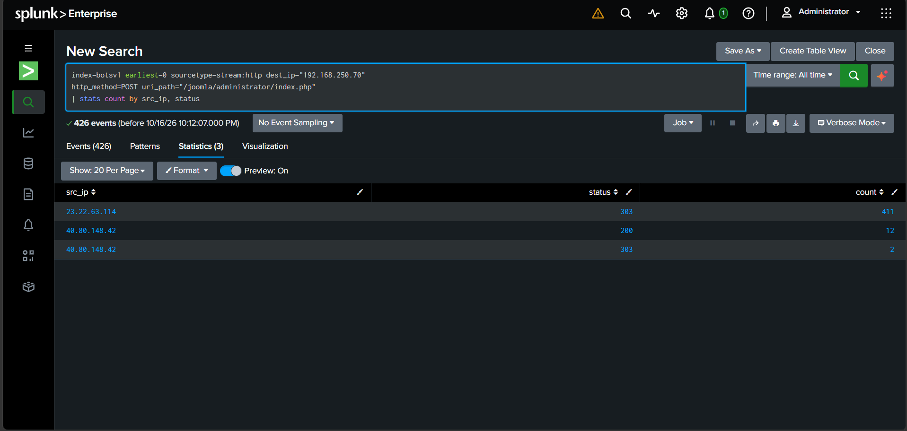

#### 12. Administrative Activity

**File:** `detections/12_admin_activity.spl`

The IP `40.80.148.42` accessed the administrator login page at 03:18:00 IST and submitted a login request at 03:18:05. Subsequent requests accessed administrative pages and template files. Another login POST appeared at 03:20:31.

The activity was consistent with administrative access followed by changes or actions within the Joomla interface.

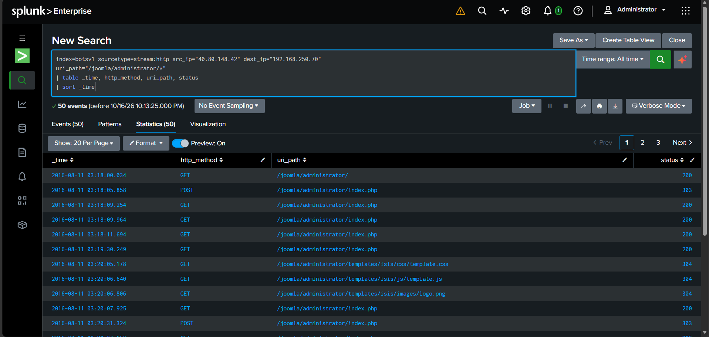

### Phase 3: File Upload and Endpoint Execution

#### 13. File Upload Event

**File:** `detections/13_upload_event.spl`

At 03:22:47 IST, an HTTP POST carried two filenames, `3791.exe` and `agent.php`, to the web server. The request used the IE11 user-agent string.

The parsed source IP was blank, so I investigated the raw event rather than relying on the extracted field.

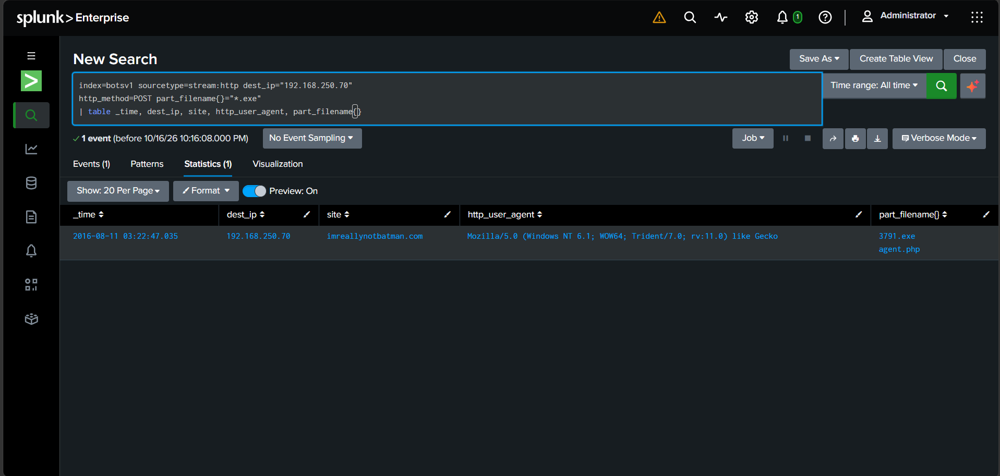

#### 14. Upload Source Attribution

**File:** `detections/14_upload_source_ip.spl`

The binary payload affected normal field extraction. I used a regular expression against the raw event to recover the source IP.

The three relevant events at 03:21:11, 03:21:12 and 03:22:47 IST were associated with `40.80.148.42`.

This supported the attribution of the upload activity to that IP in the available logs.

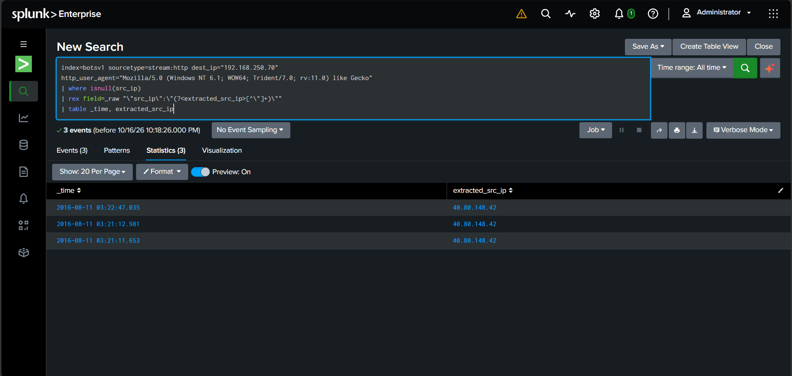

#### 15. Requests to agent.php

**File:** `detections/15_agent_php_requests.spl`

The logs showed 194 requests to `/joomla/agent.php` from `23.22.63.114`. Of these, 193 returned HTTP 200.

The volume and timing made the endpoint suspicious, especially given the earlier upload of `agent.php`. However, HTTP 200 indicates a successful HTTP response, not necessarily successful execution of every intended action.

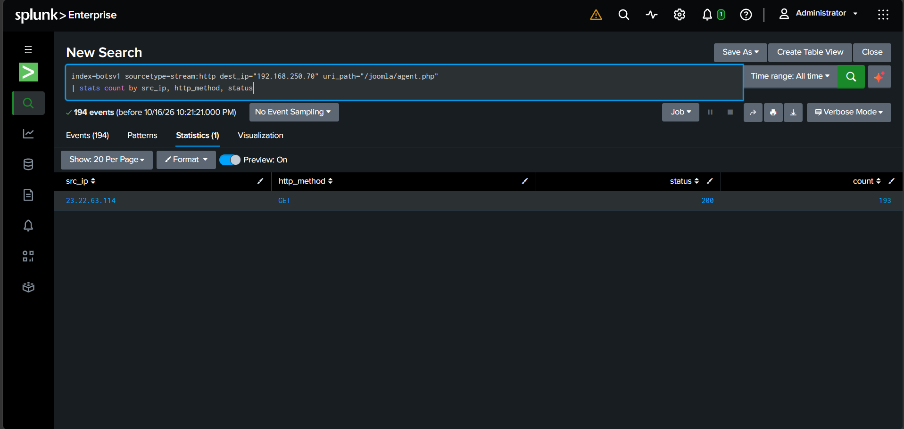

#### 16. agent.php Request Timing

**File:** `detections/16_agent_php_timing.spl`

The first observed request to `agent.php` occurred at 03:25:22 IST, and the last at 03:51:34 IST.

The first request occurred 2 minutes and 35 seconds after the upload event at 03:22:47. The timing and endpoint name suggest a relationship between the uploaded file and subsequent activity, but the script contents were not analyzed.

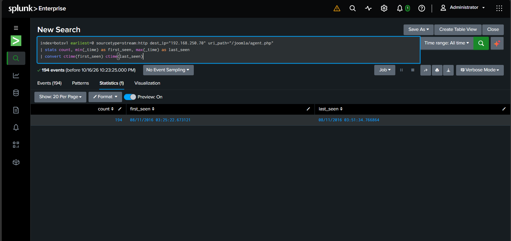

#### 17. Sysmon Process Execution

**File:** `detections/17_sysmon_execution.spl`

Sysmon recorded the following process activity on `we1149srv`:

| Time (IST) | Parent process | Process | Command |
|---|---|---|---|
| 03:26:18 | `php-cgi.exe` | `cmd.exe` | `cmd.exe /c "3791.exe 2>&1"` |
| 03:26:18 | `cmd.exe` | `3791.exe` | `3791.exe` |
| 03:28:23 | `3791.exe` | `cmd.exe` | `C:\Windows\system32\cmd.exe` |
| 03:38:13 | `3791.exe` | `cmd.exe` | `C:\Windows\system32\cmd.exe` |

The process chain showed PHP launching a command shell that executed `3791.exe`. The executable then spawned additional command shells.

This is strong evidence of unauthorized or suspicious code execution through the web server process chain. I did not analyze the executable's behavior or establish its full impact.

**File indicator:** `3791.exe`  
**MD5:** `AAE3F5A29935E6ABCC2C2754D12A9AF0`


#### 18. Host Mapping

**File:** `detections/18_host_mapping.spl`

I correlated IIS and Sysmon records to associate host `we1149srv` with `192.168.250.70`.

This connected the web server's HTTP activity with the endpoint process-execution evidence.

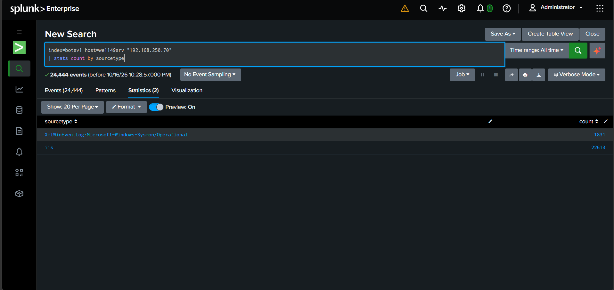

### Phase 4: Outbound Activity

#### 19. Outbound Destinations

**File:** `detections/19_outbound_connections.spl`

Suricata records associated the server with:

- `prankglassinebracket.jumpingcrab.com`, associated with `23.22.63.114`
- `update.joomla.org`, associated with normal Joomla update-check activity

The Joomla update activity was assessed as benign based on the available context. The other destination required further investigation.

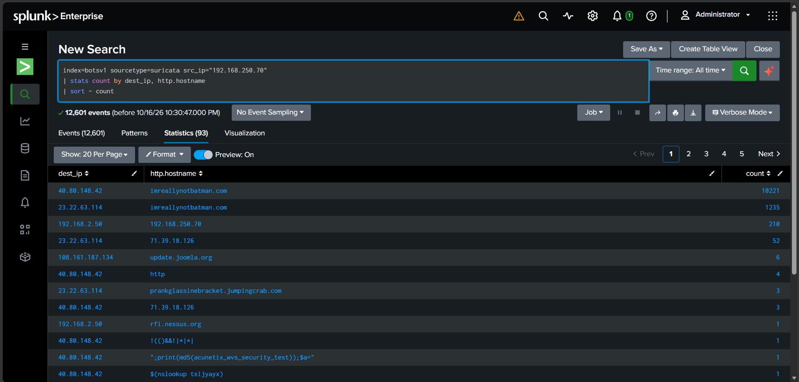

#### 20. Suspicious File Download

**File:** `detections/20_defacement_download.spl`

The firewall logs showed the web server requesting the following file from `prankglassinebracket.jumpingcrab.com:1337`:

`/poisonivy-is-coming-for-you-batman.jpeg`

The requests occurred at 03:36:21, 03:43:46 and 03:49:10 IST.

The non-standard port, unusual filename and relationship to the earlier suspicious activity made these requests worth escalating. The filename suggests a possible defacement-related artifact, but I did not observe evidence that the website itself had been defaced.

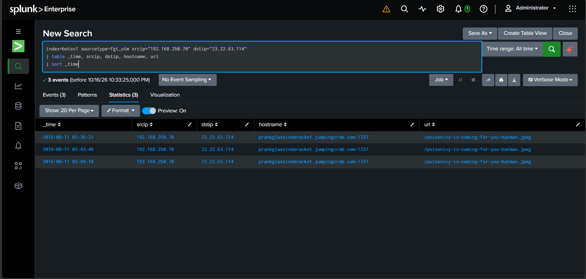

#### 21. DNS Lookups

**File:** `detections/21_dns_lookups.spl`

The logs showed internal host `192.168.250.20` querying `8.8.8.8` for the attacker-associated domain at 03:36:21, 03:41:23 and 03:41:30 IST.

The role of `192.168.250.20` was not confirmed. Further investigation would be needed to determine whether it was an approved DNS resolver or another host involved in the activity.

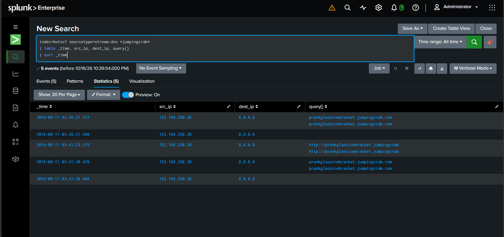

### Phase 5: Incident Timeline

#### 22. Correlated Attack Timeline

**File:** `detections/22_attack_timeline.spl`

I consolidated the main events to understand the sequence of activity and identify relationships between the external IPs.

Some events had no parsed `src_ip` value and appeared under a NULL field grouping. This limitation was considered when interpreting the timeline.


## Consolidated Timeline

| Time (IST) | Time (UTC) | Event |
|---|---|---|
| ~03:05 | 21:35, 10 Aug | Scanning activity from `40.80.148.42` |
| 03:15:21 | 21:45:21, 10 Aug | Brute-force activity from `23.22.63.114` |
| 03:16:33 | 21:46:33, 10 Aug | Password `batman` submitted by the script |
| 03:18:05 | 21:48:05, 10 Aug | Same password submitted from `40.80.148.42` |
| 03:22:47 | 21:52:47, 10 Aug | `3791.exe` and `agent.php` uploaded |
| 03:25:22 | 21:55:22, 10 Aug | Requests to `agent.php` begin |
| 03:26:18 | 21:56:18, 10 Aug | PHP process launches command shell and `3791.exe` |
| 03:36:21 | 22:06:21, 10 Aug | First observed image download |
| ~03:55 | ~22:25, 10 Aug | Observed suspicious activity largely stops |

## Triage Verdicts

| Finding | Verdict | Severity | Confidence |
|---|---|---|---|
| Acunetix scanning | True positive — scanning activity | Medium in isolation; high in incident context | Confirmed |
| Joomla brute-force activity | True positive — credential attack | High | Confirmed |
| Administrative login using `batman` | Suspected successful authentication | Critical impact potential | Likely |
| Upload of `3791.exe` and `agent.php` | True positive — suspicious file upload | Critical | Confirmed |
| Execution of `3791.exe` | True positive — suspicious code execution | Critical | Confirmed |
| Repeated `agent.php` requests | True positive — suspicious endpoint activity | High | Activity confirmed; purpose unverified |
| Outbound image download | True positive — suspicious outbound activity | High | Download confirmed; defacement unobserved |
| Internal host `192.168.2.50` | Needs verification | Low | Authorization unconfirmed |
| Joomla update check | Benign | Informational | Consistent with normal update activity |

**Overall incident assessment: Critical.** The evidence of a PHP process launching a command shell and executing an uploaded binary warrants immediate escalation to Tier 2.

## Indicators of Compromise

| Type | Indicator | Context |
|---|---|---|
| IP address | `40.80.148.42` | Scanning, administrative activity and file upload |
| IP address | `23.22.63.114` | Brute-force activity, `agent.php` requests and image hosting |
| Domain | `prankglassinebracket.jumpingcrab.com` | Associated with suspicious outbound activity |
| Port | `1337` | Observed image download destination |
| URL path | `/poisonivy-is-coming-for-you-batman.jpeg` | Requested three times |
| File | `3791.exe` | Executed on the web server |
| MD5 | `AAE3F5A29935E6ABCC2C2754D12A9AF0` | Hash of `3791.exe` |
| File | `agent.php` | Uploaded and subsequently requested 194 times |
| File path | `C:\inetpub\wwwroot\joomla\3791.exe` | Executable location |
| User agent | `Python-urllib/2.7` | Associated with brute-force requests |
| User agent | `Mozilla/5.0 (Windows NT 6.1; WOW64; Trident/7.0; rv:11.0) like Gecko` | Associated with administrative activity and upload |
| Credential | `admin` / `batman` | Treat as compromised pending verification |

These indicators were identified in a simulated dataset. They should be validated before being used in production detection or blocking rules.

## MITRE ATT&CK Mapping

The following mappings describe observed behavior or investigative hypotheses. A mapping does not establish that every aspect of a technique was confirmed.

| Tactic | Technique | ID | Evidence and qualification |
|---|---|---|---|
| Reconnaissance | Active Scanning: Vulnerability Scanning | T1595.002 | Acunetix-related signature and scanning traffic |
| Credential Access | Brute Force: Password Guessing | T1110.001 | Automated password attempts |
| Initial Access | Valid Accounts | T1078 | Possible use of `admin` / `batman`; successful authentication inferred |
| Initial Access | Exploit Public-Facing Application | T1190 | Exploit-like signatures observed; successful exploitation mechanism not established |
| Command and Control | Ingress Tool Transfer | T1105 | File-transfer activity; exact payload behavior remains unknown |
| Execution | Windows Command Shell | T1059.003 | `cmd.exe` execution observed in Sysmon |
| Persistence | Server Software Component: Web Shell | T1505.003 | Possible, based on `agent.php`; file not analyzed |
| Impact | Defacement: External Defacement | T1491.002 | Possible; suspicious filename observed, but defacement not confirmed |

## Recommended Tier 2 Actions

These are recommendations for the next investigation stage. I did not perform these actions as part of this Tier 1 exercise.

1. **Containment:** Assess the business impact and isolate `we1149srv` (`192.168.250.70`) in accordance with the incident response procedure.
2. **Network controls:** Evaluate blocking `40.80.148.42`, `23.22.63.114` and the associated domain at appropriate security controls.
3. **Evidence preservation:** Preserve `3791.exe`, `agent.php`, relevant logs and other artifacts for controlled analysis.
4. **Malware analysis:** Calculate and verify file hashes, check reputation sources and analyze the executable and PHP file in a safe environment.
5. **Credential security:** Reset the Joomla administrator password, review privileged accounts and investigate possible credential reuse.
6. **Scope assessment:** Search other hosts for the executable hash, suspicious filenames, attacker-associated IPs and related process activity.
7. **Web integrity:** Review Joomla files, templates, administrator settings and website content for unauthorized changes.
8. **Internal host validation:** Confirm the role of `192.168.250.20` and whether `192.168.2.50` is an authorized vulnerability scanner.
9. **Detection improvements:** Review administrative login protections, rate limiting, access restrictions and alerting for PHP-to-command-shell execution.

## Investigation Limitations

- HTTP 303 responses did not conclusively establish whether the administrative login succeeded.
- The source IP for the upload was recovered from raw events because normal field extraction was incomplete.
- `3791.exe` and `agent.php` were not analyzed, so their full functionality is unknown.
- The relationship between the two external IPs is based on correlated activity and timing; common ownership was not proven.
- The role of `192.168.250.20` and the authorization status of `192.168.2.50` remain unverified.
- No reputation lookups, live containment, malware analysis or forensic remediation were performed.
- Lateral movement, data exfiltration and the full scope of compromise were not investigated.
- Website defacement was not confirmed.

## What I Learned

- An alert is a starting point for investigation, not a final verdict.
- Authentication must be evaluated using the available evidence rather than a single HTTP status code.
- Raw event inspection and regular expressions can help recover fields when normal parsing fails.
- Correlating network, web server and endpoint logs provides stronger evidence than investigating each alert in isolation.
- Incident timelines help connect apparently separate events and prioritize escalation.
- Documenting uncertainty and investigation limits is part of a defensible SOC report.

## About

**Yakub Pasha Mohammed**  
Aspiring SOC Analyst | Security Monitoring | Alert Triage | Splunk SPL

GitHub: [yakubpashamohammed](https://github.com/yakubpashamohammed)

This project demonstrates hands-on practice with SIEM searches, log correlation, alert triage, incident documentation and escalation using a simulated security dataset.
